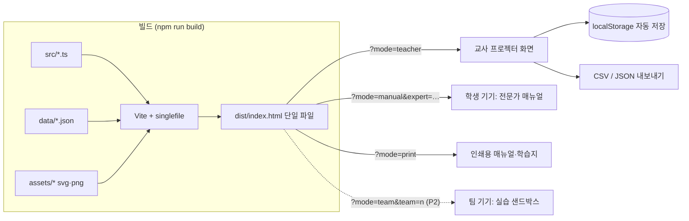
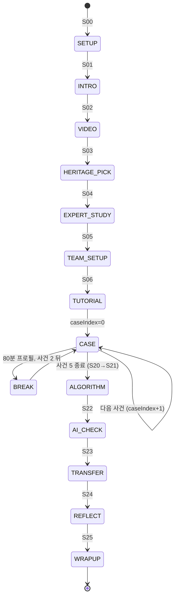
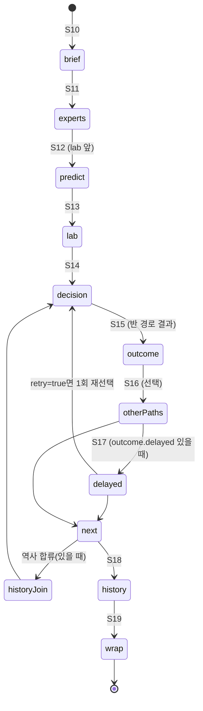

# 03. 시스템 구조

## 1. 전체 그림

- 서버 없음. 모든 기기가 **같은 파일**을 각자 연다(USB, 공유 드라이브, 교내 웹 서버 어느 쪽이든 가능).
- 교사 화면과 학생 기기는 **동기화하지 않는다**. 팀 결과는 교사가 교사 화면에 입력한다.

## 2. 저장소 구조(구현 시 목표)
```
src/
├─ main.ts                 모드 분기
├─ core/
│  ├─ store.ts             단일 상태 저장소(불변 갱신, 구독)
│  ├─ lessonMachine.ts     수업 단계 상태 기계
│  ├─ caseRunner.ts        사건 flow 실행기(docs/05)
│  ├─ scoring.ts           팀별 건강도·근거 배지
│  ├─ logger.ts            이벤트 로그 → CSV/JSON
│  ├─ persistence.ts       localStorage 저장·복원(try/catch)
│  ├─ timer.ts             단계 타이머
│  ├─ keyboard.ts          키 매핑·클리커
│  └─ rng.ts               seedrandom 래퍼
├─ content/
│  ├─ loadContent.ts       data/*.json 로드 + 런타임 검증
│  └─ types.ts             scenario.schema.json과 같은 타입
├─ engine/
│  ├─ graph.ts             노드 조회, 다음 단계 계산
│  └─ algorithmMatrix.ts   단계 태그 집계(docs/05 §6)
├─ labs/
│  ├─ labHost.ts           공통 실습 틀(POE, 빠른 모드, 기준 사진)
│  ├─ lab1Galvanic.ts
│  ├─ lab2Fragments.ts
│  ├─ lab3Adhesive.ts
│  ├─ lab4TapeTest.ts
│  └─ lab5Pagoda.ts
├─ ui/
│  ├─ stage.ts             1920×1080 무대 + 비율 맞춤
│  ├─ screens/S00…S25.ts   화면(docs/04)
│  ├─ components/          TeamVotePanel, ExpertBadge, OutcomeMark, HealthBar,
│  │                       TimerChip, TeacherPanel, Modal, QrCard, PrincipleCard
│  └─ theme.css
├─ modes/
│  ├─ teacher.ts
│  ├─ manual.ts
│  ├─ print.ts
│  └─ team.ts              (P2)
assets/
├─ illustrations/          사건·증거 카드 일러스트(SVG)
├─ textures/               녹·갈라짐 질감(사전 생성 PNG)
└─ pilot/                  (선택) 실물 실습 기준 사진
tools/validate-scenario.mjs
tests/unit, tests/e2e
```

## 3. 모드
| 모드 | 대상 | 화면 | 저장 |
|---|---|---|---|
| teacher | 프로젝터 | S00~S25 + 교사 패널 | 자동 저장, 내보내기 |
| manual | 학생 기기(전문가) | M01 매뉴얼, M02 퀴즈 | 퀴즈 결과만 그 기기에 |
| print | 인쇄 | P01 매뉴얼 4종, P02 학습지 W1~W4 | 없음 |
| team (P2) | 팀 기기 | 현재 사건의 실습을 팀이 직접 조작 | 없음 |

## 4. 상태 모델 (TypeScript 개요)
```ts
type ProfileId = "120" | "80";
type TeamId = 1 | 2 | 3 | 4;
type ExpertId = "metal" | "glass" | "paint" | "adhesive";
type ResultType = "solved" | "worse" | "irreversible";
type StepKey = "investigate" | "rootCause" | "reversible" | "minimal" | "evidence";

interface AppState {
  sessionId: string;              // 시작 시각 기반
  profile: ProfileId;
  phase: LessonPhase;             // §5
  phaseStartedAt: number;
  caseIndex: number;              // 0..4
  caseCursor: number;             // cases[i].flow 안 위치
  teams: Record<TeamId, TeamState>;
  classPath: PathEntry[];         // 반 전체가 실제로 지나간 결정과 결과
  predictions: Record<string, Record<TeamId, string | string[]>>; // labId → 팀별 예측
  labResults: Record<string, unknown>;                              // labId → 측정값
  algorithmNotes: string[];       // 알고리즘 도출 때 교사가 입력한 학생 발화
  aiCheck: { answerText?: string; checks: Record<StepKey, boolean | null> };
  settings: { quickLabs: boolean; skipOptional: boolean; showTeacherPanel: boolean };
}

interface TeamState {
  name: string;                   // "1팀" 등. 학생 이름 금지
  health: Record<string, number>; // caseId → 남은 건강도(시작 10)
  votes: Record<string, { choice: "A" | "B" | "C"; reasons: string[] }>; // nodeId → 투표
  badges: string[];               // 획득한 원칙 카드 ID
}

interface PathEntry {
  caseId: string; nodeId: string; choice: "A" | "B" | "C";
  result: ResultType; decidedBy: "majority" | "teacher";
  step: StepKey; at: number;
}
```

## 5. 수업 단계 상태 기계


### 5.1 사건 내부(caseRunner)
`cases[i].flow` 배열을 순서대로 실행한다. 항목 종류:

- `optional: true`인 결정은 `settings.skipOptional`이 켜지면 건너뛴다(80분 프로필 기본값).
- 실습(lab)은 `settings.quickLabs`가 켜지면 빠른 모드로 돈다.

## 6. 이벤트 로그와 저장
- 모든 상태 변화는 `logger.append(event)`를 거친다. 이벤트: `phase_enter`, `prediction`, `lab_metric`, `vote`, `decision`, `outcome`, `delayed_shown`, `retry`, `history_shown`, `algorithm_note`, `ai_check`, `export`.
- 자동 저장: 이벤트마다 `localStorage["cons-lab:<sessionId>"]`에 상태와 로그를 저장한다. 저장 실패는 무시하고 화면 구석에 작은 경고만 표시.
- 시작 화면(S00): 저장된 세션이 있으면 "이어하기 / 새로 시작" 선택(앱 내 모달).
- 내보내기: CSV(분석용)와 JSON(전체 복원용). 스키마는 docs/10.

## 7. 키보드·클리커
| 키 | 동작 |
|---|---|
| → / PageDown / Space | 다음 |
| ← / PageUp | 이전(직전 입력 취소, 결과 공개 전까지만) |
| 1 2 3 4 | 팀 선택(투표 입력 대상) |
| A B C | 선택한 팀의 선택지 입력 |
| R | 근거 태그 패널 열기(선택한 팀) |
| Enter | 결정 확정 / 결과 공개 |
| O | 다른 길 보기 |
| F | 시간 빨리 감기(지연 결과) |
| H | 실제 역사 공개 |
| T | 교사 패널 열기·닫기 |
| P | 타이머 일시정지 |
| G | 알고리즘 매트릭스(사건 5 뒤) |
| E | 내보내기 |
| Esc | 모달 닫기 |
클리커는 보통 PageDown/PageUp을 보내므로 '다음/이전'만으로 전체 진행이 가능해야 한다(투표 입력은 마우스 또는 숫자·문자 키).

## 8. 화면 무대와 반응형
- 기준 무대 1920×1080(16:9). `transform: scale()`로 창 크기에 맞춘다. 레이아웃은 무대 좌표로 설계한다.
- 최소 글자 크기(무대 기준): 본문 32px, 보조 26px, 선택지 40px, 제목 56px.
- 교사 패널은 무대 위 오른쪽 슬라이드 패널(폭 560px). 학생에게 보이지 않게 하려면 '듀얼 모니터'에서 `?mode=teacher&panel=window`로 별도 창을 띄우는 옵션(P2).

## 9. 타이머
- 단계마다 프로필 기본 시간. 남은 시간 칩이 노랑(30초 전)·빨강(초과)으로 바뀐다. 자동으로 넘어가지 않는다.
- 교사 패널에서 ±1분 조정. 실제 소요 시간은 로그에 남긴다(수업 후 시간표 보정용).

## 10. 오류 처리
- 콘텐츠 로드 시 런타임 검증 실패 → 교사 화면에 오류 목록 표시, 수업 진행 불가 상태로 명확히 알림.
- 실습 렌더 오류 → "실습을 건너뛰고 증거 카드로 진행" 버튼(증거 카드 = `lab.fallbackEvidence` 문구).
- 알 수 없는 노드 ID → 개발 모드에서는 예외, 배포 모드에서는 사건 정리(S19)로 이동.

## 11. 보안·오프라인
- `<meta http-equiv="Content-Security-Policy" content="default-src 'self' 'unsafe-inline' data: blob:; connect-src 'none'; frame-src 'none'">` 로 외부 요청을 원천 차단(단일 파일 인라인 스크립트라 unsafe-inline 필요).
- 영상 링크는 `window.open`으로 새 탭에서만 연다(앱 안에 iframe으로 넣지 않는다).
- API 키·외부 AI 호출 코드 금지.

## 12. 성능 예산
- `dist/index.html` ≤ 5 MB, 첫 화면 2초 이내(일반 교사용 노트북).
- 질감 이미지는 빌드 전에 PNG로 미리 만들어(algorithmic-art) 압축 후 내장한다. 런타임 p5.js는 쓰지 않는다.
