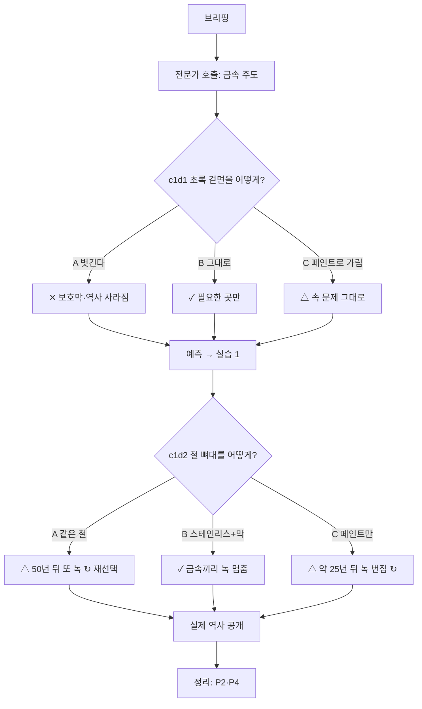

# 05. 선택-결과 그래프 엔진

## 1. 용어
| 용어 | 뜻 |
|---|---|
| 사건(case) | 실제 역사 사례 하나. `cases[]` |
| 흐름(flow) | 사건 안에서 실행할 항목의 순서 배열. 갈라졌다 다시 모이는 구조의 '모이는 지점'을 만든다 |
| 결정 노드(decision) | 선택지 A/B/C가 있는 문제 상황 |
| 결과 노드(outcome) | 선택의 결과: `solved`(✓ 해결) / `worse`(△ 악화) / `irreversible`(✕ 되돌릴 수 없음) |
| 지연 결과(delayed) | 결과 노드에 붙는 "N년 뒤" 추가 결과와 추가 감점 |
| 재선택(retry) | 지연 결과 뒤 반 경로에 한해 같은 결정을 한 번 더 고르는 기회 |
| 역사 합류(historyJoin) | "실제 역사에서는 ~였어요"를 보여주고, 다음 결정을 실제 역사 상태에서 시작하게 하는 카드 |
| 단계 태그(step) | 결정이 시험하는 원칙 단계(`investigate` 등 5종). 알고리즘 매트릭스의 열 |
| 반 경로(classPath) | 다수결(동점 시 교사 결정)로 반 전체가 실제로 따라간 선택 |

## 2. 데이터 구조
정식 정의는 `data/scenario.schema.json`. 핵심만:

```jsonc
{
  "id": "case1",
  "lead": "metal", "support": ["adhesive", "paint"],
  "flow": ["brief", "experts", "c1d1", "predict", "lab", "c1d2", "history", "wrap"],
  "lab": { "id": "lab1", "predict": { "type": "rank", "prompt": "…", "options": ["…"] }, "fallbackEvidence": "…" },
  "nodes": [
    { "id": "c1d1", "type": "decision", "step": "minimal", "optional": false,
      "prompt": "…", "context": "…",
      "choices": [ { "key": "A", "label": "…", "outcome": "c1d1A" }, … ] },
    { "id": "c1d1A", "type": "outcome", "result": "irreversible", "text": "…", "principle": "P4" },
    { "id": "c1d2A", "type": "outcome", "result": "worse", "text": "…", "principle": "P2",
      "delayed": { "label": "50년 뒤", "text": "…", "extraDelta": -2 }, "retry": true },
    { "id": "c3j1", "type": "historyJoin", "text": "…" }
  ],
  "history": { "lines": ["…"], "sources": [ { "title": "…", "url": "…" } ] },
  "wrap": { "principles": ["P2", "P4"], "question": "…" }
}
```

흐름 항목 키워드: `brief`, `experts`, `predict`, `lab`, `lab:A`, `lab:B`(실습을 두 부분으로 나눌 때), `history`, `wrap`. 그 밖의 문자열은 노드 ID다(결정 또는 역사 합류).

## 3. 실행 규칙 (caseRunner)
1. `flow`를 앞에서부터 실행한다.
2. 결정 노드:
   - `optional: true`이고 `settings.skipOptional`이면 건너뛴다(로그 `skipped`).
   - S14에서 팀 투표 입력 → 확정 시 반 경로 결정: 최다 득표 선택지. 동점이면 교사가 고른다.
   - 반 경로 선택지의 결과 노드를 S15에 보여준다.
   - S16(다른 길 보기)은 교사가 O를 누를 때만.
   - 반 경로 결과 또는 어떤 팀의 결과에 `delayed`가 있으면 S17을 거친다.
   - 반 경로 결과에 `retry: true`이고 이 결정에서 아직 재선택을 안 했으면, S17 뒤 "다시 고르기"를 제안한다. 재선택은 결정당 1회.
3. 역사 합류 노드: 카드를 보여주고 다음 항목으로 간다. 이후 결정은 반 경로와 무관하게 '실제 역사 상태'에서 시작한다는 전제로 쓰여 있다.
4. `history` → S18, `wrap` → S19. 사건 종료.
5. **✕ 결과가 나와도 흐름은 계속된다**(막다른 길 금지). ✕는 건강도 감점과 "사고 보고서" 발문(교사 패널)으로만 처리한다.

## 4. 점수
- 팀마다 사건별 유물 건강도 10에서 시작(`healthStart`).
- 결정마다 **그 팀이 고른 선택지의 결과**로 감점한다(반 경로와 달라도).
  - 기본 감점: `outcomeTypes[result].healthDelta` (solved 0, worse −2, irreversible −5). 결과 노드에 `healthDelta`가 있으면 그것을 우선.
  - 지연 감점: 그 결과에 `delayed`가 있으면 S17에서 `extraDelta`를 추가로 적용하고 화면에 표시.
  - 건강도는 0 아래로 내려가지 않는다.
- 재선택 때 팀들도 다시 투표한다. 첫 투표의 감점은 그대로 남고, 두 번째 투표 결과가 solved가 아니면 그 감점을 더한다(결과는 되돌릴 수 없다는 메시지).
- 투표하지 않은 팀은 감점 없이 '미입력'으로 로그.
- 원칙 카드: 팀이 고른 결과가 `solved`이면 그 결과 노드의 `principle` 카드를 얻는다.
- 근거 배지: 팀의 근거 태그에 그 결정의 단계 원칙(예: `rootCause` → `P2`)이 있거나 `lab`/`manual` 태그가 있으면 +1. 점수와 별도로 표시(근거를 칭찬하는 장치).
- 최종 화면 기본값은 순위 없음. 팀별 합계는 교사 패널에서만 보인다(옵션으로 공개).

## 5. 다른 길 보기와 지연 결과의 연출 원칙
- 다른 길 보기는 '정답 공개'가 아니라 '모든 길의 결과 비교'다. ✓가 둘 이상인 결정도 허용한다(정답이 하나가 아닌 경우).
- 지연 결과는 "지금은 해결된 것처럼 보였던" 선택에 주로 붙인다(겉만 고치기, 강한 접착제, 콘크리트).
- 지연 결과 문구는 사실에 근거한다. 실제 역사에서 일어난 일이면 `history`와 연결된다(예: 1911년 타르 페인트 → 25년 뒤 뼈대 교체).

## 6. 알고리즘 매트릭스 (S20)
- 입력: 반 경로(또는 팀별 투표), 각 결정의 `step`.
- 행 = 사건 1~5, 열 = 단계 5종(P1~P5 순서), 칸 = 그 단계 태그가 붙은 결정에서 나온 결과 기호 목록.
- 건너뛴 선택적 결정은 칸에 회색 점(·)으로 표시.
- 열 강조: 같은 원칙이 여러 사건에서 반복됨을 보여준다.
- 부가 행: "불려 간 전문가" — 사건별 주도·보조 전문가. 접착이 다섯 사건 모두에 있음을 드러낸다.
- 그래프 보기: 사건별 결정 노드를 왼쪽→오른쪽으로 놓고 반 경로를 굵게. 다섯 그래프를 같은 높이로 나란히 그려 모양을 비교하게 한다.

### 단계 태그 분포(현재 데이터 기준)
| 사건 | 결정 → 단계 |
|---|---|
| 1 여신상 | c1d1 → minimal, c1d2 → rootCause |
| 2 꽃병 | c2d1 → investigate (선택적), c2d2 → reversible |
| 3 가면 | c3d1 → investigate, c3d2 → reversible, c3d3 → reversible (선택적) |
| 4 단청 | c4d1 → investigate, c4d2 → rootCause (선택적) |
| 5 석탑 | c5d1 → reversible, c5d2 → evidence |

다섯 단계가 모두 한 번 이상 나오고, '되돌릴 수 있게'가 가장 자주 나온다(접착 허브와 일치).

## 7. 검증 규칙 (`npm run validate`)
오류(E)는 빌드 실패, 경고(W)는 보고만.

| ID | 규칙 | 등급 |
|---|---|---|
| V01 | 모든 노드 ID가 전체에서 유일 | E |
| V02 | 모든 flow 항목이 키워드이거나 같은 사건의 노드 ID | E |
| V03 | 결정 노드의 선택지는 2~3개, key는 A/B/C 중 중복 없음 | E |
| V04 | 선택지의 outcome이 같은 사건의 결과 노드를 가리킴 | E |
| V05 | 결정마다 solved 결과가 1개 이상 | E |
| V06 | 결정의 step이 5종 중 하나 | E |
| V07 | 결과 노드의 principle이 P1~P5 중 하나 | E |
| V08 | delayed가 있으면 label·text가 있고 extraDelta ≤ 0 | E |
| V09 | retry: true는 delayed가 있는 worse/irreversible 결과에만 | E |
| V10 | flow에 `predict`/`lab`이 있으면 case.lab이 있고 labs.config에 그 ID가 있음 | E |
| V11 | `predict`는 `lab`(또는 `lab:A`)보다 앞 | E |
| V12 | history.sources가 1개 이상이고 모두 url이 있음 | E |
| V13 | lead·support가 전문가 4종 중 하나, lead는 support에 없음 | E |
| V14 | 다섯 단계가 전체 사건에서 각각 1번 이상 등장 | E |
| V15 | 사건마다 optional이 아닌 결정이 1개 이상 | E |
| V16 | 전문가마다 lead 사건이 1개 이상 | W |
| V17 | 문구 길이: brief 줄 ≤ 45자, prompt ≤ 35자, 선택지 ≤ 45자, 결과 문구 ≤ 90자 | W |
| V18 | 학생 문구에 금지어('문화재', '정답', '틀렸다') 없음 | W |
| V19 | 모든 결과 노드가 어떤 선택지에서 참조됨(고아 노드 없음) | W |

참조 구현: `tools/validate-scenario.mjs`(의존성 없음). 구현 단계에서 Ajv 스키마 검증을 앞에 붙인다.

## 8. 예시: 사건 1 그래프


## 9. 예외 상황
| 상황 | 처리 |
|---|---|
| 한 팀도 투표 안 하고 확정 | 확정 불가, 안내 문구 |
| 반 경로가 ✕ | 결과·사고 보고서 발문 후 정상 진행 |
| 재선택에서도 같은 선택 | 그대로 진행(두 번째 감점 적용) |
| 교사가 '이전'으로 돌아감 | 결과 공개 전까지만 취소 가능. 공개 후에는 되돌리지 않음(앱도 '되돌릴 수 없음'을 체험) |
| 시간 부족 | 교사 패널 '이 결정 건너뛰기'(optional만) / '실습 건너뛰기(증거 카드)' |
